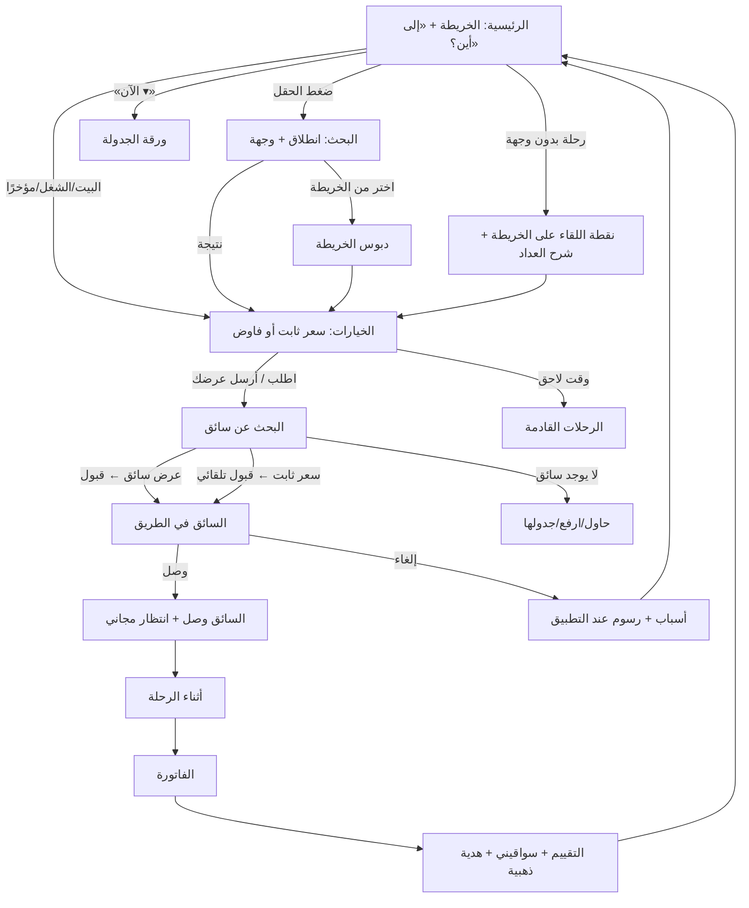
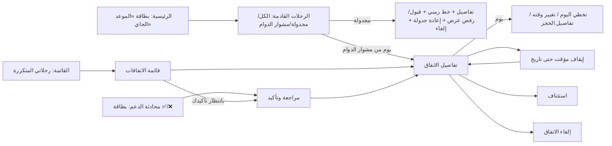
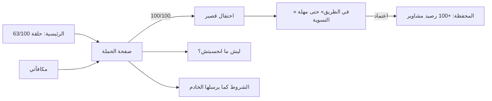

# تاكسيستا للراكب — إعادة تصميم كاملة لتجربة الاستخدام (UI/UX)

> **مرحلة تصميم ومراجعة فقط.** لم يُعدَّل أي ملف في `lib/` أو `ios/` أو `android/` أو `pubspec.*`، ولم يُنشر أي شيء، ولم يُلمس الخادم أو قاعدة البيانات.
> الفرع: `design/rider-ux-redesign` (من `integration/taxista-unified-current` عند `6989fbe`، إصدار التطبيق 6.7.5+47).
> كل الأرقام والأسماء داخل النموذج **عيّنات تجريبية**.

## فهرس

0. [الملخص وكيف تراجع](#0)
1. [منهجية الجرد](#1)
2. [خريطة الشاشات والتفاعلات (Screen & Interaction Inventory)](#2)
3. [خريطة تدفقات المستخدم](#3)
4. [تقييم مشاكل UI/UX الحالية](#4)
5. [الاتجاهان البصريان A و B والتوصية](#5)
6. [نظام التصميم (Design System)](#6)
7. [الحركة والتفاعلات الدقيقة (Motion & Microinteractions)](#7)
8. [تغطية كل الحالات](#8)
9. [التدفقات بعد إعادة التصميم — قسمًا قسمًا](#9)
10. [المكافآت والولاء — المنطق الحقيقي والتصميم](#10)
11. [الميزات الجديدة الحية في الخادم وكيف تظهر](#11)
12. [قبل / بعد وطريقة المراجعة والملاحظات](#12)
13. [قائمة «لا شيء محذوف»](#13)
14. [خطة التنفيذ في Flutter بعد الاعتماد](#14)
15. [الفجوات المعروفة](#15)

---

## 0. الملخص وكيف تراجع

**الملفات المسلّمة**

| الملف | ما هو |
|---|---|
| `design/prototype/index.html` | نموذج تفاعلي عالي الدقة، ملف واحد (369KB)، يفتح في أي متصفح على الكمبيوتر أو الموبايل. فيه 55 شاشة و26 نافذة سفلية/حوار، تبديل A/B، فاتح/داكن، تقليل الحركة، 3 خطوط، حالات كل شاشة، وصندوق ملاحظات. |
| `design/prototype/src/*` + `build.py` | مصدر النموذج (يُعدَّل ثم `python3 design/prototype/build.py`). |
| `design/screens/*.png` | 38 لقطة جاهزة للمراجعة في المحادثة (2x). |
| `design/DECISIONS_NEEDED.md` | القرارات التي تحتاج موافقتك، مع الخيارات وتوصيتي. |
| هذا الملف | التقرير الكامل. |

**طريقة المراجعة في 5 دقائق**

1. افتح `design/prototype/index.html` (على الكمبيوتر يظهر الهاتف وبجانبه لوحة التحكم؛ على الموبايل اضغط زر «☰ الشاشات والملاحظات»).
2. جرّب المسار الكامل من الرئيسية: «إلى أين؟» ← اكتب «ميدان» ← اختر ← «فاوض بسعرك» ← كوبون ← اطلب ← اقبل عرض ← «بدء الرحلة» ← «إنهاء الرحلة» ← الفاتورة ← التقييم. لاحظ رسالة +1 رحلة نحو مكافأة 100 رحلة.
3. افتح «مكافأة 100 رحلة» من الرئيسية، واضغط «الوصول إلى 100» ثم «اعتماد المكافأة» ثم افتح المحفظة.
4. افتح «مشوار الدوام» ← اضغط يومًا ← «تخطي هذا اليوم»، ثم «إيقاف مؤقت».
5. بدّل A/B والوضع الداكن من اللوحة، واضغط «حالات هذه الشاشة» (تحميل، خطأ، بدون إنترنت، رفض الإذن…).
6. اكتب ملاحظتك في الصندوق («هذا الزر مش عاجبني») ← «حفظ» ← في النهاية «نسخ الكل» والصقها لي. كل ملاحظة تُحفظ مع اسم الشاشة والاتجاه والوضع، فأعرف بالضبط ماذا تقصد.

**التوصية باختصار:** الاتجاه **A (بسيط وهادئ) كأساس للتطبيق كله**، مع **4 لمسات من B** فقط حيث تصنع فرقًا عاطفيًا: رأس المكافآت، بطاقة المحفظة، لحظة الاحتفال، شاشة البداية (التفصيل في §5).

---

## 1. منهجية الجرد

- قرأت كود Flutter بالكامل من فرع العمل (215 ملف Dart، ~70 ألف سطر): كل `MaterialPageRoute`/`guardedPush`، كل `showModalBottomSheet`/`showDialog`/`showGeneralDialog` (39 موضعًا)، كل نص عربي ظاهر، ومفاتيح الترجمة في `lib/translations/translation.dart`.
- للتأكد من **منطق المكافآت الحقيقي** وحقول **الرحلات المتكررة** و**بطاقات الدردشة**، قرأت (قراءة فقط) ملفات الخادم: `app/Services/Rewards/Campaigns/CampaignRules.php`، `Api/V1/Request/PromotionCampaignController.php`، `Api/V1/Request/RecurringRideController.php`، `Services/RecurringRides/RecurringRides.php` (`present()` و`dayState()`)، `Api/V1/Request/ChatController.php`. لم أعدّل شيئًا هناك.
- **المحاكي:** لم أشغّل التطبيق على المحاكي؛ اعتمدت على جرد الكود (سمح الموجز بذلك). لذلك «قبل» في المقارنة مبني على الكود، لا على لقطات حقيقية. لم أدّعِ أي نتيجة على جهاز.
- النموذج اختُبر آليًا في Chrome بدون واجهة: فتح كل الشاشات بكل حالاتها (لا أخطاء، لا تمرير أفقي على عرض 360 و390)، وتشغيل مسار كامل بالنقر من البحث حتى الدفع (23 خطوة نجحت).

---

## 2. خريطة الشاشات والتفاعلات (من الكود)

الرموز: **BS** = Bottom Sheet، **D** = Dialog، **P** = صفحة مستقلة، **O** = طبقة فوق الخريطة.

### 2.1 البداية والدخول

| الشاشة | الملف | الوصول | الأزرار / ماذا تفعل | ما بعدها | الحالات والرسائل | الحركة الحالية |
|---|---|---|---|---|---|---|
| التحميل | `pages/loadingPage/loadingpage.dart`, `loading.dart` | فتح التطبيق | — | لغة ← دخول، أو الخريطة، أو الحجز الجاري، أو الفاتورة | «الاتصال بطيء…»، «الإنترنت ضعيف جدًا» | `TaxiLaunchOverlay` (1050ms) عند الإقلاع البارد |
| التحديث الإجباري/المتاح | `update/forced_update_page.dart`, `update_offer.dart` | بوابة التحديث | «تحديث الآن»، «لاحقًا» (إن لم يكن إجباريًا) | المتجر | «تعذّر فتح المتجر…»، نسخة ليست من Google Play | — |
| اختيار اللغة | `pages/language/languages.dart` | أول تشغيل | العربية/English، تأكيد | الدخول | — | — |
| التعريف (Onboarding) | `pages/login/onboarding_pages.dart` | — | تخطي/التالي | — | 4 شرائح (ضمان، دعم 24، الوضوح، وصول سلس) | — |
| الدخول | `login/auth/modern_login.dart` | من التحميل | تبويب الهاتف/البريد، الدولة، كلمة المرور، «نسيت كلمة المرور»، «إنشاء حساب جديد» | الخريطة | بيانات خاطئة، تعذّر الاتصال، تعذّر تحديد الدولة | — |
| استعادة الحساب | `login/auth/modern_forgot_password.dart` | من الدخول | رقم ← رمز واتساب (6 أرقام، عدّاد إعادة) ← كلمة جديدة | الدخول + رسالة | انتهاء جلسة الاستعادة | — |
| التسجيل | `login/auth/modern_signup.dart` + `auth_policy.dart` | من الدخول | **8 خطوات**: الاسم، الدولة، المنطقة، البريد، كلمة المرور، الهاتف، الرمز، الجنس | الموافقة | أخطاء لكل حقل | `AnimatedSwitcher` تلاشٍ |
| الموافقة | `login/agreement.dart` | بعد التسجيل | موافقة على الشروط والخصوصية، «إنشاء الحساب» | الخريطة | «جارٍ إنشاء حسابك…»، فشل الإنشاء | — |
| رمز الإحالة | `pages/referralcode/referral_code.dart` | بعد التسجيل | إدخال/تخطي | — | رمز غير صحيح | — |
| هدية التسجيل | `onTripPage/widgets/signup_welcome_gift_dialog.dart` | أول دخول للخريطة إن أُضيفت الهدية | «ابدأ رحلتك» | — | تظهر مرة واحدة (SharedPreferences) | Scale easeOutBack 360ms |
| بدون إنترنت | `pages/noInternet/nointernet.dart` | عند الانقطاع | الرجوع للرئيسية | — | — | — |

### 2.2 الرئيسية والخريطة والبحث

| الشاشة | الملف | الأزرار / ماذا تفعل | ما بعدها | الحالات / نوافذ |
|---|---|---|---|---|
| الخريطة الرئيسية | `onTripPage/map_page.dart` + `map_page/*` | زر القائمة، توسيط الموقع، بطاقات البيت/العمل/مؤخرًا (`home_quick_actions.dart`)، «رحلة بدون وجهة»، «ابحث عن مكان أو عنوان» | البحث، `PickupLocation`، الحجز | إذن الموقع (`map_permission_states.dart`, `location_permission_sheet.dart`)، نوع النقل تاكسي/توصيل (`map_mode_sheet.dart`)، بانر عروض الرحلات المجدولة (`scheduled_offer_banner.dart`)، **بطاقة حملة لا تنضغط** (`_RiderPromotionHomeCard`)، بطاقة «حجوزاتك/رحلة جارية»، عرض استرجاع رحلة (`map_recovery_offer.dart`: «نعم، أريد الرحلة / لا، شكرًا»)، بانر إعلان (`map_advertisement_banner.dart`)، الشخصية الكرتونية (mascot) مع اسم الراكب |
| لوحة تحديد الرحلة | `map_page/widgets/trip_selection_panel.dart` | موقع الانطلاق، «أدخل وجهتك»، آخر الأماكن، «اختيار من الخريطة»، مسح، متابعة | — | «جارٍ تحديد موقعك الحالي»، «لا توجد أماكن سابقة بعد» |
| ورقة الوجهة | `map_page/map_destination_sheet.dart` | البيت/العمل، النتائج | — | **«اكتب 4 أحرف على الأقل»**، «لا نتائج»، «جاري البحث» |
| بحث الرحلة | `onTripPage/trip_location_search.dart` | حقل البحث، الأماكن المحفوظة، الأخيرة، «حدّد على الخريطة» | `trip_map_picker.dart` | «تعذّر البحث الآن…»، «لم نتمكن من تحديد هذا العنوان…» |
| اختيار الانطلاق (بدون وجهة) | `onTripPage/pick_loc_select.dart` (1873 سطر) | تحريك الخريطة، تأكيد | الحجز | — |
| اختيار الوجهة | `onTripPage/drop_location/*` (2227 سطر) | دبوس، توقفات | الحجز | — |
| العناوين المفضلة | `NavigatorPages/fav_address.dart`, `favourite.dart` | إضافة/تعديل/حذف البيت والعمل وأخرى | اختيار من الخريطة | تأكيد الحذف (D) |

### 2.3 طلب الرحلة (Booking Confirmation)

| الجزء | الملف | ما يفعله |
|---|---|---|
| خيارات السيارة | `booking_confirmation_vehicle_options.dart`, `widgets/vehicle_service_card.dart` | «اختر السيارة والسعر الأنسب لرحلتك»، اقتصادي/عادي، «الأكثر طلبًا»، «السعر العادل»، «عرضك»، «عدّل السعر لإرسال عرض للسائق»، هدية أول رحلة والمتبقي نقدًا |
| نمط السعر | `models/ride_pricing_mode.dart` | `fixedFare` (اقتصادي) أو `riderOffer` (مفاوضة) حسب `pricing_mode`/`enable_bidding` للخدمة |
| الكوبون | `booking/apply_coupons.dart` | إدخال/إزالة، «تم الخصم، وفّرت …» أو رفض |
| الدفع | `widgets/payment_method_sheet.dart` (+ legacy) | نقد، محفظة، محفظة+نقد، بطاقة (حسب التفعيل) |
| الجدولة | `booking/ride_later_sheet.dart`, `widgets/ride_schedule_sheet.dart` | الآن/بعد ساعة/بعد ساعتين/غدًا صباحًا، تاريخ ووقت، رحلة ذهاب وعودة |
| التفضيلات | `booking/preferences_sheet.dart` | أمتعة، حيوانات أليفة |
| لشخص آخر | `widgets/rider_contact_sheet.dart`, `NavigatorPages/pickcontacts.dart` | اسم، رقم، تعليمات، من جهات الاتصال |
| تفاصيل الرحلة | `widgets/trip_details_sheet.dart` | مراجعة نقطة اللقاء والوجهة، «أضف توقف» |
| سائق مفضل متاح | `community/favorite_driver_choice.dart` | «سائقك المفضل متاح الآن — اطلب …»، يُعرض عليه أولًا |
| أجار / بين المدن | `booking_confirmation_rental_options.dart`, `NavigatorPages/outstation.dart`, `historyoutstationdetails.dart` | باقات أجار؛ رحلات بين المدن مع عروض السائقين قبول/رفض |
| توصيل أغراض | `onTripPage/choosegoods.dart` | اختيار نوع البضاعة (حسب التفعيل) |
| إرسال الطلب | `functions/booking_send.dart`, `booking_confirmation_modal_overlays.dart` | «الإنترنت ضعيف… نعيد إرسال طلبك (المحاولة x من y). طلبك لن يتكرر ولن يضيع.» |
| تغيّر السعر | `booking_confirmation_immediate_request.dart` | «تغيّر سعر الرحلة إلى … راجع السعر ثم اطلب مجددًا» |

### 2.4 البحث عن سائق وما بعده

| الشاشة | الملف | الأزرار / الحالات |
|---|---|---|
| البحث عن سائق | `booking_confirmation_searching_*.dart`, `searching/nearby_driver_selection.dart`, `booking_confirmation_pending_request.dart` | «جارٍ التواصل مع السائقين القريبين»، «طلبك ظاهر الآن لأقرب N سائقين»، «نوسّع نطاق البحث»، وقت البحث، عروض السائقين («أقدر أوصلك بـ…»، قبول عرض)، «خيارات الطلب»، الدعم، «إلغاء الطلب» |
| لا يوجد سائق | `booking_confirmation_status_overlays.dart` | «نكمل نلقالك سواق…»، إلغاء |
| تأكيد عرض سائق | `booking_confirmation_controller.dart` | D: «لقينالك سواق — … مستعد يوصلك. تأكده؟» نعم/لا |
| السائق قادم / الرحلة | `booking_confirmation_active_ride.dart`, `booking_confirmation_map_controls.dart`, `widgets/trip_contact_actions.dart` | بيانات السائق واللوحة، اتصال، دردشة، مشاركة (`Share.share`)، SOS (`widgets/sos_sheet.dart`: «خبر الإدارة»)، «سيصل السائق خلال دقائق»، وقت الانتظار، **«عند إلغاء الطلب سيتم خصم 2.5 دل»** (نص ثابت) |
| الإلغاء | `widgets/cancellation_sheet.dart` | أسباب من الخادم + «أماكن مختلفة/أخرى»، إشعار رسوم الاسترجاع |
| الدردشة مع السائق | `chatPage/chat_page.dart`, `trip_chat_page.dart` | نص، رسالة صوتية، اتصال مجاني، «لم تُرسل · اضغط لإعادة المحاولة»، متاح حتى 24 ساعة بعد الرحلة |
| المكالمة | `callPage/admin_call_page.dart`, `functions/calls/*`, `widgets/call_options.dart` | CallKit، كتم، مكبر، إنهاء، شريط «مكالمة جارية — اضغط للعودة» |
| الرحلات الجارية | `onTripPage/ongoingrides.dart` | قائمة الرحلات الجارية |
| الفاتورة | `onTripPage/invoice.dart` | التفاصيل، الدفع («ادفع للسائق نقدًا»/«دُفع من محفظتك»)، تعديل السعر المتفق عليه، حماية التسعيرة |
| التقييم | `community/ride_wrap_up.dart`, `after_ride_page.dart`, `review_page.dart` | نجوم بتسميات، «ما الذي أعجبك؟»، ملاحظة، «أضف إلى سواقيني»، هدية ذهبية تدفعها تاكسيستا، إرسال/تخطي |

### 2.5 الرحلات القادمة

| الشاشة | الملف | الأزرار / الحالات |
|---|---|---|
| الرحلات القادمة | `NavigatorPages/upcoming_scheduled_rides.dart` | الحالات: تمت الجدولة، جاري البحث عن سائق، تم حجز السائق، تبدأ قريبًا، جارية، منتهية، ملغاة؛ قبول/رفض عرض السائق، إعادة الجدولة، الإلغاء، تحميل المزيد |
| حجوزاتك | `NavigatorPages/active_rider_bookings.dart` | «رحلاتك القادمة في مكان واحد»، بانتظار السائق، السائق أكد الموعد، الرحلة جارية |
| **رحلاتي المتكررة** | **غير موجودة في التطبيق** | الخادم جاهز (§11) |

### 2.6 المحفظة والدفع

| الشاشة | الملف | الأزرار / الحالات |
|---|---|---|
| المحفظة | `NavigatorPages/walletpage.dart` | الرصيد المتاح، إضافة فلوس، تحويل الأموال (رقم + مبلغ)، آخر المعاملات، تحميل المزيد، فارغ |
| إضافة فلوس | `payments/moamalat/add_money_sheet.dart` | البطاقة المصرفية (ليبيا)، رمز بطاقة الشحن؛ «غير متاح الآن»، «تظهر الطرق الأساسية فقط» |
| الشحن بمعاملات | `moamalat_topup_page.dart`, `moamalat_checkout_page.dart`, `topup_flow.dart` | المبلغ (حد أدنى/أعلى)، بطاقاتي، الدفع الآمن (WebView)، «جارٍ تأكيد الدفع… لا تُغلق»، نجاح/فشل/غير مؤكد مع رقم العملية |
| بطاقاتي + التعبئة الذكية | `saved_cards_page.dart`, `smart_fill_*`, `card_scanner.dart` | حفظ على الجهاز، مسح البطاقة، تعبئة صفحة البنك والموافقة على الشروط |

### 2.7 الحساب والقائمة

| الشاشة | الملف | ملاحظات |
|---|---|---|
| القائمة الجانبية | `navDrawer/nav_drawer.dart` | الترتيب الحالي: الملف ← عنوانك المفضل ← السجل ← الرحلات القادمة ← إشعار (عدّاد) ← خارج المحطة (بشرط) ← المحفظة (بشرط) ← SOS ← تقديم شكوى ← سجل المكالمات ← سواقيني ← مكافآتي ← إعدادات ← تواصل معنا (عدّاد) ← هدية ← تسجيل الخروج |
| الملف الشخصي | `NavigatorPages/editprofile.dart` | الاسم، البريد، الجنس، الصورة (كاميرا/معرض، أذونات) |
| السجل | `history.dart` | تبويبات: القادمة/المكتملة/الملغاة، تحميل المزيد |
| تفاصيل الرحلة | `historydetails.dart` | الأجرة، السائق، الشكوى، إلغاء رحلة مجدولة |
| سواقيني | `community/favorites_page.dart`, `driver_profile_page.dart` | قائمة، إزالة، «يفضّلك أيضًا»، صفحة السائق، أوسمة، إبلاغ، حظر |
| مكافآتي | `community/rewards_page.dart` | §10 |
| الهدية (الإحالة) | `NavigatorPages/referral.dart` | رمز الدعوة، نسخ، مشاركة |
| الإشعارات | `NavigatorPages/notification.dart` | قائمة، حذف (D)، تحميل المزيد |
| الإعدادات | `settings.dart`, `selectlanguage.dart`, `about.dart`, `faq.dart` | اللغة، «حدد الموضوع» (الوضع الداكن)، حذف الحساب (D) |
| SOS | `sos.dart`, `pickcontacts.dart` | جهات ثقة حتى 4، إذن جهات الاتصال |

### 2.8 الدعم

| الشاشة | الملف | ملاحظات |
|---|---|---|
| الدعم | `support.dart`, `contactus.dart` | «تواصل معنا»، FAQ، الخصوصية |
| محادثة الدعم | `adminchatpage.dart`, `widgets/chat/chat_kit.dart`, `widgets/voice/*`, `support_call_card.dart` | مواضيع (مشكلة في رحلة، الدفع، المحفظة والرصيد، حسابي، اقتراح)، نص + صوت، اتصال مجاني، طرق تواصل أخرى؛ **لا تفاعلات ولا بطاقات إجراء ولا «معدّلة»** |
| الشكاوى | `makecomplaint.dart`, `makecomplaintdetails.dart` | اختيار النوع ← نص ← «شكرًا…» |
| سجل المكالمات | `callPage/call_log_page.dart` | الكل/الفائتة/الواردة/الصادرة، معاودة الاتصال المجاني، المراسلة |

**المجموع:** 46 شاشة/صفحة مستقلة + 23 Bottom Sheet + 16 Dialog تقريبًا + 9 طبقات فوق الخريطة.

---

## 3. خريطة تدفقات المستخدم

### 3.1 التدفق الرئيسي (بعد التصميم)

### 3.2 الرحلات المستقبلية

### 3.3 المكافآت

---

## 4. تقييم مشاكل UI/UX الحالية

الشدة: 🔴 عالية (تضيّع المستخدم أو تخفي ميزة)، 🟠 متوسطة، 🟡 تحسين.

| # | المشكلة | الدليل في الكود | الشدة |
|---|---|---|---|
| 1 | **بطاقة حملة المكافأة في الرئيسية فيها سهم لكنها لا تنضغط** — الراكب يرى «أكملت 63 من 100» ولا يستطيع فتح التفاصيل. | `map_home_overlays.dart` `_RiderPromotionHomeCard` بدون `onTap` | 🔴 |
| 2 | **رحلاتي المتكررة غير موجودة** رغم أن الخادم حي؛ والتأكيد يتم فقط بالكتابة في الدردشة. | لا يوجد أي استدعاء لـ `recurring-rides` في `lib/` | 🔴 |
| 3 | **صفحتان للرحلات القادمة** («حجوزاتك» و«الرحلات القادمة») بمنطقين مختلفين، ولا تظهر أيام مشوار الدوام. | `active_rider_bookings.dart` + `upcoming_scheduled_rides.dart` | 🔴 |
| 4 | البحث عن الوجهة يبدأ بعد **4 أحرف** — بطيء للأسماء القصيرة (مثل «سوق»). | `map_destination_sheet.dart` «اكتب 4 أحرف على الأقل» | 🔴 |
| 5 | القائمة الجانبية 15+ عنصر بلا تجميع، وأسماء مربكة: «هدية» (= الإحالة)، «خارج المحطة» (= بين المدن)، «إشعار» مفرد، «تواصل معنا» (= محادثة الدعم). | `nav_drawer.dart`، `translation.dart` | 🟠 |
| 6 | شارات العدّ في القائمة بيضاء على خلفية فاتحة (`buttonColor = Colors.white`) — شبه غير مرئية. | `nav_drawer.dart` + `styles.dart` | 🟠 |
| 7 | التسجيل **8 خطوات** قبل أول رحلة (الاسم، الدولة، المنطقة، البريد، كلمة المرور، الهاتف، الرمز، الجنس) + صفحة موافقة. | `auth_policy.dart` `SignupField` | 🟠 |
| 8 | حجم الخط مقفول على 1.0 — يتجاهل إعداد الهاتف (مشكلة وصول لكبار السن). | `main.dart` `TextScaler.linear(1.0)` | 🟠 |
| 9 | ثلاثة أنظمة ألوان متوازية (ألوان `styles.dart` العامة، `CommunityLook` و`ChatPalette`، وألوان ثابتة في الرئيسية مثل `0xff1677F8`/`0xff10264A`) — أزرق مختلف من شاشة لأخرى، ودعم الوضع الداكن جزئي. | `styles.dart`, `community_kit.dart`, `map_home_overlays.dart` | 🟠 |
| 10 | مقاسات مبنية على `media.width * 0.037` بدل مقياس خط ثابت — النصوص تكبر وتصغر مع عرض الشاشة. | `styles.dart` (eight… fourty) | 🟠 |
| 11 | نص رسوم الإلغاء ثابت «سيتم خصم 2.5 دل» يظهر دون شرط واضح. | `booking_confirmation_active_ride.dart` | 🟠 |
| 12 | «رحلة بدون وجهة» لا تشرح كيف تُحسب الأجرة قبل الطلب. | `map_collapsed_sheet.dart` → `PickupLocation` | 🟠 |
| 13 | الأرصدة الثلاثة (رصيد مشاوير، أموالك، في الطريق) تظهر في «مكافآتي» فقط؛ المحفظة لا تفرّق بينها. | `rewards_page.dart` vs `walletpage.dart` | 🟠 |
| 14 | تعديل الوجهة أثناء الرحلة غير موجود (مطلوب في الموجز). | لا يوجد في `booking_confirmation_active_ride.dart` | 🟡 |
| 15 | صفحة الإشعارات لا تفرّق الأنواع ولا تفتح الشاشة المرتبطة. | `notification.dart` | 🟡 |
| 16 | أخطاء التحميل في مكافآتي وسواقيني: نص فقط «اسحب للأسفل» بدون زر إعادة. | `rewards_page.dart`, `favorites_page.dart` | 🟡 |
| 17 | انتقالات صفحات جيدة ومتسقة مع RTL (`TaxistaPageTransitionsBuilder`) — **نحتفظ بها** ونبني عليها. | `navigation/taxista_page_transitions.dart` | ✅ |
| 18 | تجربة «الإنترنت الضعيف… طلبك لن يتكرر ولن يضيع» ممتازة — **نحتفظ بالنص والسلوك**. | `booking_confirmation_modal_overlays.dart` | ✅ |

---

## 5. الاتجاهان البصريان

### A — Clean & Minimal (بسيط وهادئ)
- الخريطة هي البطلة؛ ورقة سفلية بيضاء بحقل «إلى أين؟» كبير.
- أسطح بيضاء، حدود 1px رفيعة، ظلال خفيفة جدًا، زوايا 12–16–28.
- أزرار مسطحة بلون واحد (#0873FF)، لا تدرّجات.
- حركة قصيرة (120–320ms)، بدون زخارف.

### B — Modern Premium Mobility (مميز وحديث)
- رأس وبطاقات بطولية بتدرّج كحلي ← أزرق (`#0A1F44 → #0B3E9C → #0873FF`).
- زوايا أكبر (14–20–24–32)، ظلال أعمق، بطاقات بلا حدود.
- زر أساسي بتدرّج أزرق ← سماوي مع توهّج خفيف، شارة العملات الذهبية في الرئيسية.
- حلقة المكافآت متدرّجة، قائمة جانبية برأس متدرّج.

### المقارنة

| المعيار | A | B |
|---|---|---|
| الفهم لأول مرة | ممتاز | جيد |
| قوة الهوية | جيدة | ممتازة |
| الأداء والبطارية (أجهزة أندرويد متوسطة شائعة في ليبيا) | ممتاز | جيد (تدرّجات وظلال أكثر) |
| التباين تحت شمس قوية | ممتاز | جيد |
| إبراز المكافآت والمحفظة | جيد | ممتاز |
| كلفة التنفيذ | أقل | متوسطة |

### التوصية
**A كأساس، مع لمسات B في 4 أماكن فقط:** (1) رأس «مكافآتي» وحلقة 100 رحلة، (2) بطاقة رصيد المحفظة، (3) لحظة الاحتفال، (4) شاشة البداية/رأس القائمة الجانبية.
السبب: أغلب استخدام تاكسيستا لحظي (أطلب وأمشي) — البساطة تقلل الأخطاء وتسرّع الطلب، والمستخدمين أعمار وخبرات متنوعة. لكن المكافآت والمحفظة تحتاج «إحساسًا بالقيمة» يشجع العودة، وهنا يكسب B. كل اللمسات الأربع محصورة في مكونات قليلة، فلا تزيد كلفة التنفيذ كثيرًا. (قرار رقم 1 في `DECISIONS_NEEDED.md`.)

---

## 6. نظام التصميم

### 6.1 الألوان (Tokens)

| Token | فاتح | داكن | الاستعمال |
|---|---|---|---|
| `brand` | `#0873FF` | `#3D8BFF` | الأزرار الأساسية، الروابط، المسار (هو نفس `theme` الحالي — الهوية محفوظة) |
| `brand-700` | `#0659CC` | `#2F74E0` | الضغط |
| `brand-50` | `#EAF4FF` | `#12223F` | خلفيات معلوماتية، العنصر المختار |
| `navy` | `#0A1F44` | `#0A1F44` | تدرّج B، شريط الرحلة الجارية |
| `cyan` | `#17C3E8` | `#17C3E8` | لمسة في تدرّج B فقط (موجود في الكود `themeCyan`) |
| `bg` | `#F4F6FA` | `#0A101C` | خلفية الصفحات |
| `surface` | `#FFFFFF` | `#111A2A` | البطاقات والأوراق |
| `surface-2` | `#EFF2F7` | `#182336` | الحقول، الأزرار الثانوية |
| `line` | `#E2E7EF` | `#233049` | الفواصل |
| `ink` / `ink-2` / `ink-3` | `#0E1A2B` / `#4A5668` / `#7F8CA1` | `#EAF0F8` / `#A8B5C9` / `#6E7D95` | النصوص |
| `success` | `#109A4C` | `#3CCB7F` | نجاح، متاح، إضافة فلوس |
| `warn` | `#B76E00` | `#F5B941` | تنبيه، إنترنت ضعيف |
| `danger` | `#D92D20` | `#FF6B5E` | خطأ، إلغاء، SOS |
| `gold` | `#B8860B` (+`#F2C14E`) | `#F2C14E` | المكافآت والعملات فقط |

قواعد: **لا برتقالي أطلب أبدًا** (`taxista-vs-otlop-brand-assets`)؛ الأحمر للخطر فقط؛ الذهبي للمكافآت فقط؛ نسبة تباين النص ≥ 4.5:1 (ink على bg = 16:1، ink-3 على surface ≈ 4.6:1).

### 6.2 الخط

- **المقترح: IBM Plex Sans Arabic** (400/500/600/700) — واضح جدًا في الأحجام الصغيرة، أرقامه منتظمة، ومتوفر في `google_fonts` الموجودة. **البديل: Cairo** (المستعمل حاليًا في أجزاء من التطبيق) أو Tajawal. يمكن مقارنة الثلاثة مباشرة من لوحة النموذج (قرار رقم 2).
- الأرقام والأسعار: `FontFeature.tabularFigures()` واتجاه LTR داخل النص العربي حتى لا تقفز الأرقام عند العدّ.

| الدور | الحجم/الوزن | مثال |
|---|---|---|
| Display | 32–44 / 800 | المبلغ في الفاتورة، عدّاد الحلقة |
| Title | 22 / 700 | عنوان الشاشة |
| Headline | 18 / 700 | «إلى أين؟»، عنوان الورقة |
| Body | 15 / 400–600 | النص الأساسي |
| Label | 13 / 600 | الأزرار الصغيرة، الحقول |
| Caption | 11.5–12.5 / 500 | التفاصيل الثانوية |

مع إلغاء قفل `TextScaler` والسماح حتى 1.3× (قرار رقم 8).

### 6.3 المسافات والحواف والظلال
- المسافات: 4 · 8 · 12 · 16 · 20 · 24 · 32 (هامش الشاشة 16).
- الحواف A: 8 · 12 · 16 · 20 · 28 (الأوراق السفلية 28). B: 8 · 14 · 20 · 24 · 32.
- الظلال: `sh-1` قوائم، `sh-2` بطاقات، `sh-3` نوافذ وتوستات، `sheet` للأوراق.
- أهداف اللمس ≥ 44×44؛ الزر الأساسي 54 ارتفاع؛ زر الطوارئ 60.

### 6.4 الأيقونات
خطية 24px بسماكة 1.9 وزوايا دائرية (نمط Material Symbols Rounded أو Lucide). الأيقونات الاتجاهية (رجوع، سهم القائمة) تنعكس في RTL؛ أيقونات الساعة والتشغيل لا تنعكس. نستبدل صور PNG الحالية في القائمة (`settings.png`, `chat (1).png`…) بأيقونات متجهة موحّدة.

### 6.5 المكوّنات (كلها في النموذج، شاشة «نظام التصميم»)
`TxButton` (primary/secondary/outline/ghost/danger + loading + disabled) · `TxListTile` · `TxCard` · `TxChip`/`TxTag` · `TxInput` (عادي/تركيز/خطأ/مساعدة) · `TxSheet` (مقبض، سحب للإغلاق) · `TxDialog` · `TxBanner` (info/success/warn/danger) · `TxToast` وإشعار داخل التطبيق · `TxSkeleton` · `TxEmptyState`/`TxErrorState` · `TxProgressRing` · `TxSegmented`/`TxModeSwitch` · `TxStepper` (المبلغ) · `TxTimeline` · `TxWeekStrip` · `TxStatusChip` (حالات اليوم/الحجز) · `TxDriverCard` · `TxPlate` · `TxMap` (طبقة فوق GoogleMap) · `TxOfferCard` (بعدّاد) · `TxChatBubble` (تفاعلات، معدّلة، محذوفة، صوت) · `TxActionCard`.

---

## 7. الحركة والتفاعلات الدقيقة

| العنصر | المدة | المنحنى | ملاحظات |
|---|---|---|---|
| ضغط زر/بطاقة | 120ms | ease | `scale 0.97`، اهتزاز خفيف (haptic light) في الأزرار المهمة |
| انتقال صفحة للأمام | 320ms | `easeOutCubic` | من اليسار في RTL (+ تلاشي 0.82→1) — امتداد للموجود حاليًا |
| الرجوع | 220ms | `easeInCubic` | سحب من حافة الشاشة اليمنى للرجوع (RTL) |
| فتح ورقة سفلية | 320ms | spring (`Curves.easeOutBack` خفيف 1.05) | الغطاء 0→42% |
| إغلاق ورقة | 220ms | easeIn | بالسحب لأسفل > 90px أو سرعة > 700px/s |
| القائمة الجانبية | 320ms | easeOutCubic | تُغلق بالسحب نحو اليمين |
| اختيار نوع السيارة | 220ms | spring | البطاقة تحدّ بالأزرق، السيارة تتقدم 6px وتكبر 6% |
| مفتاح سعر ثابت/فاوض | 220ms | spring | المؤشر ينزلق |
| رسم المسار | 900ms | easeOut | مرة واحدة عند ظهور المسار |
| البحث عن سائق | 2.2s حلقة | easeOut | 3 دوائر نبض حول نقطة اللقاء + سيارات قريبة؛ **تتوقف عند الخلفية** |
| وصول عرض سائق | 320ms | spring | البطاقة تصعد 16px + اهتزاز 30ms + شريط عدّ 15s |
| تحديث موقع السائق | استيفاء خطي بين النقاط (كل تحديث Firebase) | linear | دوران حسب الاتجاه؛ بدون قفزات |
| التوست/الإشعار داخل التطبيق | 320ms دخول، 2.6–3.8s بقاء | spring | من الأعلى |
| ظهور بطاقات القوائم | 320ms، تأخير 30ms بين البطاقات (أول 6 فقط) | easeOut | |
| حلقة المكافأة | 1100ms | easeOutCubic | تمتلئ من آخر قيمة شافها الراكب للقيمة الجديدة |
| الاحتفال | ≤ 1.4s | — | 36 قصاصة، الحلقة ذهبية بتوهّج، مرة واحدة لكل استحقاق |
| تأكيد النجاح | 360ms | spring | أيقونة ✓ تكبر، اهتزاز success |
| Skeleton | 1.2s حلقة | ease-in-out | |

**تقليل الحركة:** عند تفعيل إعداد الهاتف (`MediaQuery.disableAnimations` / `accessibleNavigation`) أو مفتاح التطبيق: كل الانتقالات تصبح تلاشيًا ≤ 100ms، لا نبض ولا قصاصات ولا رسم مسار، السيارة تقفز لموقعها مباشرة. (مطبّق في النموذج: زر «تقليل الحركة».)
**البطارية:** لا حلقات حركة أثناء وجود التطبيق في الخلفية؛ تحديث الخريطة يعتمد على أحداث Firebase وليس مؤقّتًا دائمًا (متوافق مع `AppLifecycleCoordinator` الحالي).

---

## 8. تغطية كل الحالات

| التدفق | Default | Loading | Success | Error/Retry | Empty | Disabled | Offline | Permission | Confirmation |
|---|---|---|---|---|---|---|---|---|---|
| الرئيسية | ✓ | تحديد الموقع (Skeleton في الشريحة) | — | — | — | — | شريط أعلى | رفض الموقع ← «فعّل» أو «على الخريطة» | عرض استرجاع رحلة |
| البحث | اقتراحات فورية | Skeleton 280ms | تمييز التطابق | «تعذّر البحث» + الخريطة | «ما لقيناش» + الخريطة | — | المحفوظ والأخير فقط | — | — |
| اختيار من الخريطة | ✓ | «جارٍ تحديد العنوان» | — | «تعذّر تحديد هذا العنوان» (الزر معطّل) | — | ✓ | — | — | — |
| الخيارات والسعر | ✓ | Skeleton السيارات | كوبون مطبّق | «تعذر تأكيد السعر» + إعادة؛ «تغيّر السعر» | — | الزر حتى يتأكد السعر | سعر آخر تحديث + تحذير | — | — |
| البحث عن سائق | مراحل 3 | ✓ | قبول | — | لا يوجد سائق (حاول/ارفع/جدولها) | — | «نعيد إرسال طلبك (2 من 3)» | — | تأكيد الإلغاء (بدون رسوم) |
| السائق/الرحلة | ✓ | — | وصل | — | — | — | (يكمل من الذاكرة) | — | إلغاء بالأسباب والرسوم |
| الفاتورة/التقييم | ✓ | — | شكرًا + +1 رحلة | «لم يُرسل التقييم… أرسل مرة أخرى» | — | إرسال قبل النجوم | — | — | — |
| القادمة | ✓ | ✓ | قبول عرض | ✓ | ✓ | — | ✓ | — | إلغاء مجدولة |
| مشوار الدوام | ✓ | ✓ | تأكيد/تخطي/إيقاف | «تعذّر التأكيد… ما تكرر شيء» | ✓ | الجمعة غير مفعّلة | — | — | إلغاء الاتفاق، «لا» |
| المكافآت | ✓ | ✓ | الاستحقاق/الاعتماد | ✓ | — | التحويل قبل الحد | — | — | — |
| المحفظة والشحن | ✓ | ✓ | تمت الإضافة | لم تكتمل / غير مؤكد | ✓ | البطاقة غير متاحة | الطرق الأساسية فقط | — | إغلاق صفحة الدفع، تأكيد التحويل |
| الدعم | ✓ | ✓ | أُرسلت | «لم تُرسل · اضغط لإعادة المحاولة» | مواضيع سريعة | — | — | الميكروفون | ✅/❌ |

كل خلية ✓ متاحة في النموذج من «حالات هذه الشاشة».

---

## 9. التدفقات بعد إعادة التصميم

### 9.1 الرئيسية والخرائط (شاشة `home`)
- **«إلى أين؟»** حقل 58px في أعلى الورقة؛ داخله «الآن ▾» يفتح الجدولة مباشرة (بدل البحث عن زر «لاحقًا»).
- **3 بطاقات سريعة:** البيت، الشغل، مؤخرًا — ضغطة واحدة تفتح الخيارات مباشرة (نقرة واحدة بدل 3).
- **اختصاران:** «رحلة بدون وجهة» و«مشوار الدوام».
- **شريط بطاقات أفقي (كلها تنضغط):** الموعد الجاي ← القادمة؛ حلقة 63/100 ← الحملة؛ الكوبون ← الهدايا.
- **أعلى الخريطة:** القائمة (مع عدّاد الدعم)، شريحة «الزروق · قرب البيت» تفتح تغيير نقطة اللقاء، الجرس (عدّاد الإشعارات).
- **رفض الإذن:** شريط أحمر داخل الورقة + زرّا «فعّل الموقع» و«على الخريطة» — الراكب لا يتوقف أبدًا.
- **رحلة جارية / حجز قائم:** بطاقة داكنة أعلى الخريطة تفتح الرحلة (تحلّ محل بطاقة «حجوزاتك» الحالية).
- **عرض الاسترجاع:** نفس النص الحالي «وجدنا سائقًا متاحًا لرحلتك السابقة…» كبطاقة أعلى الخريطة.
- **الشخصية الكرتونية (mascot):** نقترح إبقاءها كخيار (قرار رقم 6)؛ النموذج يعرض نقطة موقع بدلها لتقليل الازدحام.

### 9.2 البحث (`search`)
- حقلا الانطلاق والوجهة معًا، مع زر تبديل؛ الوجهة في التركيز تلقائيًا.
- قبل الكتابة: آخر الأماكن + المحفوظة + «رحلة بدون وجهة».
- النتائج **من حرفين** (بدل 4) مع تمييز الجزء المطابق والمسافة (قرار رقم 4 يتعلق بكلفة Google Places).
- «ما لقيناش» يقترح الخريطة؛ بدون إنترنت يعرض المحفوظ والأخير (مخزّن أصلًا في Hive `autocomplete_cache`).
- الضغط على نتيجة ← الخيارات مباشرة (الانطلاق = موقعي ما لم يُغيَّر).

### 9.3 رحلة بدون وجهة (`mappick` بوضع nodest)
الرئيسية ← «بدون وجهة» ← الخريطة بدبوس «السائق يقابلك هنا» + شرح «تقولها للسائق — الأجرة حسب المسافة والوقت» ← الخيارات تعرض **التعرفة** (فتح/كيلو/دقيقة) بدل سعر ثابت، والزر «اطلب اقتصادي بالعداد».

### 9.4 طلب الرحلة (`options`)
- **مفتاح واحد واضح:** «سعر ثابت · تعرف السعر قبل الطلب» | «فاوض بسعرك · السائقون يردّوا بعروض». يظهر فقط إذا كانت الخدمة تدعم المفاوضة (`RidePricingMode`).
- قائمة السيارات (اقتصادي/عادي/عائلي حسب الخادم) بسعر كل واحدة، والسعر بعد الكوبون.
- **في المفاوضة:** عدّاد ±0.5، شريط عدالة (أخضر/أصفر/أحمر) ونصيحة («عرضك أقل بكثير… البحث ممكن يطوّل»)، شرائح جاهزة (−1، العادل، +1، +2)، «كيف نحسب العادل؟».
- **سواقيني:** بطاقة خضراء «عبدالسلام متاح الآن — اطلبه أولًا» بمفتاح (الموجود حاليًا في `favorite_driver_choice.dart`).
- **4 خيارات في شبكة** تفتح أوراقًا صغيرة: الدفع، كوبون/هدية، الوقت، خيارات (أمتعة، حيوان، لشخص آخر، ملاحظة).
- الزر يقول بالضبط ما سيحدث: «اطلب اقتصادي · 12.50 د.ل» / «أرسل عرضك · 11.00 د.ل» / «جدول الرحلة».

### 9.5 البحث عن سائق (`searching`)
- عنوان ثابت + 3 مراحل (أرسلنا ← يشاهدونه ← قبول) + عدّاد وقت + عدد السائقين.
- العروض تظهر كبطاقات مع «قبول»/«رفض» وشريط 15 ثانية، والسعر مقارنةً بعرضك.
- «ارفع العرض» و«إلغاء الطلب» دائمًا ظاهران؛ زر الطوارئ أعلى.
- **لا يوجد سائق:** «ما عليك أي رسوم» + حاول/ارفع/جدولها/رجوع.
- **إنترنت ضعيف:** نفس الرسالة الممتازة الحالية.

### 9.6 السائق في الطريق ← الرحلة ← النهاية
- `found`: «يوصلك خلال 4 دقائق» + شريط تقدّم + بطاقة السائق (لوحة كبيرة واضحة، «من سواقيني») + 4 أزرار ثابتة (اتصال مجاني، رسالة، مشاركة، طوارئ) + تفاصيل قابلة للطي + «إلغاء الرحلة» كرابط ثانوي.
- **وصل:** «عندك 3:00 دقائق انتظار مجانًا» + إشعار داخل التطبيق.
- `ontrip`: وقت الوصول، المتبقي، الأجرة، شريط تقدّم، «تعديل الوجهة» (مقترح — قرار رقم 5)، «شارك الرحلة»، الطوارئ.
- **الإلغاء:** أسباب (من الخادم) + «سبب آخر» بنص، والرسوم **تظهر فقط عندما تنطبق** (بعد وصول السائق) — الزر الأساسي «لا، كمّل الرحلة».
- **الطوارئ:** ضغط مطوّل ثانيتين «اتصل بالطوارئ»، «خبّر إدارة تاكسيستا»، «شارك موقعك مع جهات الثقة»، رابط جهات الثقة.
- `invoice`: المبلغ المطلوب نقدًا كبير، ما خُصم من المحفظة، الكوبون، التفاصيل، «مشكلة في الرحلة؟».
- `rate`: نجوم بتسميات (سيئة…ممتازة)، شرائح حسب التقييم (إيجابي/سلبي)، ملاحظة، «أضف إلى سواقيني»، «أهدِ 20 عملة ذهبية (تدفعها تاكسيستا)»، وبعد الإرسال توست «رحلتك تنحسب نحو مكافأة 100 رحلة (64/100) إذا استوفت الشروط».

### 9.7 الرحلات المستقبلية — §11.

### 9.8 القائمة الجانبية (`drawer`) — تجميع جديد، لا شيء محذوف
رأس: الصورة والاسم والرقم + شريحتا **الرصيد** و**63/100**.
- **رحلاتي:** الرحلات القادمة (عدّاد) · رحلاتي المتكررة (جديد) · سجل الرحلات · سواقيني · عناويني المفضلة · رحلات بين المدن (إن فُعّلت).
- **فلوسي ومكافآتي:** المحفظة (إن فُعّلت `show_wallet_feature_on_mobile_app`) · مكافآتي · الهدايا والكوبونات (= «هدية» الحالية + الكوبونات).
- **المساعدة والأمان:** دعم العملاء (عدّاد) · الإشعارات (عدّاد) · سجل المكالمات · تقديم شكوى · الطوارئ وجهات الثقة.
- **التطبيق:** الإعدادات · تسجيل الخروج · رقم الإصدار.

### 9.9 المحفظة
رصيد كلي = أموالك + رصيد مشاوير (مع شرح «؟»)، 4 إجراءات (إضافة فلوس، تحويل، بطاقاتي، مكافآتي)، آخر المعاملات، صفحة معاملات بفلاتر (الكل/إضافة/خصم/مكافآت)، تفاصيل كل معاملة مع «مشكلة في هذه المعاملة؟». إضافة فلوس: البطاقة المصرفية (معاملات، ليبيا فقط) / بطاقة شحن / من صديق. الشحن: مبلغ كبير + شرائح، حدود، بطاقاتي، التعبئة الذكية، صفحة الدفع، «جارٍ التأكيد… لا تُغلق»، نجاح بقصاصات خفيفة، فشل «لم تُضف أي أموال».

### 9.10 بقية الأقسام
- **الملف الشخصي:** إحصاءات (رحلات، سواقيني، عملات)، الرقم مقفل مع شرح، الجنس اختياري.
- **السجل وتفاصيله:** تبويبات مكتملة/ملغاة/القادمة، بطاقة بخط زمني، تفاصيل مع خريطة، **«اطلب نفس الرحلة»** و**«خليها مشوار متكرر»** (جديد، يستعمل نفس الواجهات)، راسل السائق (24 ساعة)، شكوى.
- **سواقيني:** حالة التوفر، «اطلبه الآن»، «نبّهني لما يتاح»، صفحته، إزالة بتأكيد.
- **الهدايا والكوبونات:** رمز الدعوة (نسخ/مشاركة) + كوبوناتي + إدخال رمز + هدايا تاكسيستا ورابط المكافآت.
- **الإشعارات:** §11.
- **الدعم:** محادثة / اتصال مجاني، مواضيع سريعة، FAQ قابل للطي، شكوى، سجل المكالمات.
- **الشكاوى:** النوع ← الرحلة المرتبطة + النص + صورة ← رقم الشكوى ورد خلال 24 ساعة في المحادثة.
- **سجل المكالمات:** نفس الفلاتر الأربعة، معاودة الاتصال والمراسلة لكل سطر.
- **الإعدادات:** اللغة، المظهر (فاتح/داكن/تلقائي)، تقليل الحركة، حجم الخط، الإشعارات حسب النوع، عن التطبيق، حذف الحساب بتحذير واضح.
- **الدخول/التسجيل:** §12 والقرار رقم 3.

---

## 10. المكافآت والولاء — المنطق الحقيقي والتصميم

### 10.1 ما يقوله الكود فعلًا (بدون افتراض)
مصدر الحملات: `GET /api/v1/request/promotions` (التطبيق: `functions/parts/promotions.dart`)، والملخص: `GET /api/v1/rewards/summary` (`community/community_api.dart`). منطق الخادم في `CampaignRules.php`:

- **حملة «100 رحلة = 100 دينار»** هي من نوع `completed_rides` بقيمة `required_rides = 100` و`reward_amount = 100` (الأرقام إعدادات من الإدارة، ليست ثابتة في الكود).
- **ما يُحسب:** الرحلات **المكتملة فقط**، **الملغاة لا تُحسب**. إن وُجد `minimum_ride_amount` تُحسب الرحلات التي قيمتها ≥ الحد. وتنطبق قواعد البرنامج `rideRules()`: حد أدنى للمسافة والمدة والعمولة، وحد أقصى لرحلات نفس الزوج (راكب/سائق) في اليوم.
- **نافذة العدّ:** `count_period` = مدة الحملة أو أسبوع أو شهر؛ `period_ends_at` نهاية النافذة الحالية.
- **التكرار:** `repeat_mode` = مرة واحدة (`once`) / مرة في كل فترة / تتكرر كلما أكملت العدد؛ مع حد `max_awards_per_user` اختياري. `can_earn_more=false` ← «حصلت على مكافأة هذه الحملة».
- **مهلة التسوية:** `settle_hours` ← المكافأة «في الطريق» (`pending_amount`, `pending_until`) ثم تُعتمد (`credited_amount`) إذا بقيت الرحلة مكتملة.
- **الوجهة:** `reward_destination` = `ride_credit` («رصيد مشاوير»: يُستخدم في الرحلات، لا يُحوَّل ولا يُسحب) أو `wallet`.
- **عدم الجمع:** إن لم تكن `stackable` تُصرف المكافأة الثانية في الرحلة التالية.
- **الميزانية:** `budget_paused` ← «اكتملت ميزانية هذه الحملة، وقد تتأخر المكافأة»، والحملة لا تُعرض لمن لم يبدأ.
- **الشروط:** نص `terms` يأتي جاهزًا من الخادم (نص الإدارة أولًا، وإلا يُولَّد) — **نعرضه كما هو**.
- أنواع أخرى موجودة: `weekly_extra` (رحلتين أكثر من أسبوعك المعتاد)، `comeback` (العودة بعد الغياب)، `return_trip` (رحلة العودة خلال 12 ساعة/500 م)، `signup_bonus` (الهدية الترحيبية).
- العملات الذهبية: `coins`، `conversion_threshold`، `pending_coins`، `expiring_in_30_days`، تحويل بمفتاح منع التكرار.

### 10.2 التصميم
- **الرئيسية:** حلقة صغيرة 63 + «باقي 37 رحلة على 100 د.ل» — **تنضغط** (إصلاح المشكلة 🔴 رقم 1).
- **مكافآتي:** بطاقة بطولية بحلقة 112px (متدرّجة في B)، ثم الأرصدة الثلاثة (كل واحد يشرح نفسه)، العملات الذهبية، حملات أخرى، الإنجازات، آخر الحركات، مفتاح العروض.
- **صفحة الحملة (`campaign`):** حلقة 188px، «باقي N رحلة»، معالم 25/50/75/100 **للتحفيز فقط** (مكتوب «المكافأة عند 100» — لا وعود مالية في المعالم)، حقائق (رحلات محسوبة، تنتهي، تُضاف كرصيد مشاوير، التكرار)، **الشروط بنص الخادم**، «ليش رحلة ما انحسبتش؟» (القواعد أعلاه بدون أرقام مفترضة)، سجل الرحلات المحسوبة والملغاة.
- **عند الاستحقاق:** احتفال ≤ 1.4s ونص صادق: «مكافأتك 100.00 د.ل في الطريق — تُضاف كرصيد مشاوير بعد 24 ساعة إذا بقيت الرحلات مكتملة».
- **عند الاعتماد:** إشعار + سطر في المحفظة «مكافأة 100 رحلة +100.00 · رصيد مشاوير» + الرصيد يتحدث.
- **حالات:** الميزانية انتهت، انتهت الحملة، حصلت عليها — كلها في النموذج.
- **أمر مهم للتنفيذ:** «+1 رحلة» بعد التقييم يجب أن يأتي من إعادة جلب `/promotions` وليس عدًّا محليًا، لأن الخادم قد لا يحسب الرحلة (قرار رقم 7).

---

## 11. الميزات الجديدة الحية في الخادم

### 11.1 رحلاتي المتكررة / مشوار الدوام
**الواجهات:** `GET/POST /api/v1/request/recurring-rides`، `GET /{uuid}`، `POST /{uuid}/confirm|decline|skip|move-day|pause|resume|cancel` (`RecurringRideController.php`).
**الحقول المعروضة (`present()`):** `label`، `status` + `status_label` (مسودة، بانتظار تأكيد الراكب، نشط، موقوف مؤقتًا، ملغي، انتهى)، `pattern`، `pickup_time`، `days`، `starts_on/ends_on`، `paused_until`، `pick/drop` (+`route` الحقيقي)، `service`، `payment` (كاش/محفظة…)، `price` (رسمي/خصم/يدفع)، `pricing_note`، `driver_note` («كل يوم يجيك سائق متاح؛ ما فيش سائق ثابت»)، `next`، `days_list` (آخر 30 يومًا بحالة كل يوم)، `problems`، `presets` (أيام العمل/يوميًا/أيام أختارها).
**حالات اليوم (`dayState()`) وتصميمها:**

| state | النص | اللون/الأيقونة |
|---|---|---|
| scheduled | مجدول | أزرق/ساعة |
| searching | نبحث عن سائق | أصفر/بحث |
| reserved | سائق حجز الموعد | أزرق/شخص |
| driver_ready | السائق أكد استعداده | أخضر/✓ |
| driver_on_way | السائق في الطريق / السائق وصل | أخضر/سيارة |
| trip_started | الرحلة بدأت | أخضر/مسار |
| completed | مكتملة | أخضر/✓ |
| skipped | تم التخطي | رمادي/تخطي |
| cancelled | ألغيت | أحمر/× |
| no_driver | تعذر توفير سائق (+ «ما عليك أي رسوم») | أحمر/تنبيه |
| failed | ما تجهزتش | أحمر/تنبيه |

**الشاشات:** `recurring` (قائمة + بطاقة «بانتظار تأكيدك» بزرّين + «كيف يشتغل؟» + طلب جديد)، `recConfirm` (خريطة المسار الحقيقي، الأيام، الوقت، الدفع، تفصيل السعر، ✅ أؤكد / ❌ لا)، `recDetail` (الأسبوع يومًا يومًا، الأيام الماضية، إيقاف/استئناف/إلغاء)، ورقة اليوم (تخطي هذا اليوم فقط / غيّر وقت هذا اليوم / تفاصيل الحجز)، ورقة الإيقاف (أسبوع/أسبوعين/حتى أرجعه → `until`)، `recNew` (3 خطوات؛ الإنشاء من التطبيق يخضع لبوابة التجربة `pilotGate` — قرار رقم 9).
**رسائل الخادم تُعرض كما هي** (مثلًا «تمام، تخطينا مشوار … باقي الأيام كما هي.»).

### 11.2 محادثة الدعم
- **`action_card` من نوع `recurring_confirm`:** بطاقة داخل المحادثة بعنوان الاتفاق وملخصه وزرّين ✅ أؤكد / ❌ لا ← تستدعي `confirm`/`decline`، وتتحول بعد الضغط لسطر حالة. «عرض التفاصيل» يفتح `recConfirm`.
- **التفاعلات:** ضغط مزدوج على أي رسالة (بدون تكبير: `touch-action: manipulation` في الويب، و`GestureDetector(onDoubleTap)` بدون `InteractiveViewer` في Flutter) ← شريط 6 رموز ← يظهر التفاعل أسفل الفقاعة. حقل `reactions[{emoji, mine, by}]` من `ChatController`.
- **الرسائل المعدّلة والمحذوفة:** «معدّلة» بجانب الوقت؛ المحذوفة «تم حذف هذه الرسالة» بإطار متقطع (أو تختفي — قرار رقم 10).

### 11.3 الرحلات القادمة (موحّدة)
صفحة واحدة تجمع: المجدولة (`getUpcomingScheduledRides`) + الحجوزات القائمة (`getActiveRiderBookings`) + أيام مشوار الدوام المفتوحة (`days_list` بحالة planned/booking/booked). فلتر: الكل / مجدولة / مشوار الدوام؛ تجميع باليوم؛ بانر عروض السائقين. تُفتح من الرئيسية (بطاقة الموعد الجاي)، من القائمة، ومن تبويب «القادمة» في السجل.

### 11.4 الإشعارات (كلها)
كل إشعار وصل للراكب يُحفظ في القائمة (`getnotificationHistory`)، مع فلاتر (الرحلات، المحفظة والمكافآت، الدعم، العروض)، تجميع بالأيام، تمييز غير المقروء، «قراءة الكل»، وكل إشعار يفتح شاشته (Deep link — يحتاج حقل نوع/هدف من الخادم، قرار رقم 11).

---

## 12. قبل / بعد وطريقة المراجعة

في النموذج شاشة **«قبل / بعد»** (14 قسمًا): لكل قسم «قبل» من الكود، «بعد»، وزر «جرّب». أهم التغييرات في الخطوات:

| المهمة | قبل | بعد |
|---|---|---|
| طلب رحلة للبيت | فتح ← البيت ← (تأكيد الوجهة) ← خيارات ← طلب | فتح ← البيت ← طلب (**نقرتان**) |
| البحث عن «سوق» | 4 أحرف إجبارية | من حرفين + اقتراحات قبل الكتابة |
| جدولة رحلة | البحث عن «لاحقًا» داخل الحجز | «الآن ▾» في الرئيسية أو البحث أو الحجز |
| معرفة تقدّم 100 رحلة | القائمة ← مكافآتي ← تمرير | ظاهر في الرئيسية + ضغطة للتفاصيل |
| تخطي يوم من مشوار الدوام | كتابة للدعم | الرئيسية ← الموعد ← اليوم ← تخطي (**3 نقرات**) |
| تأكيد مشوار الدوام | كتابة «تمام موافق» | زر ✅ في المحادثة أو في الصفحة |
| التسجيل | 8 خطوات + موافقة | 4 خطوات |

**طريقة المشاركة:** صندوق الملاحظات في اللوحة يسجل الشاشة + الاتجاه + الوضع + نصك. «نسخ الكل» ← الصقه في المحادثة، وأعدّل النموذج فقط (`design/prototype/src`) ثم أعيد البناء، دون لمس التطبيق. أمثلة جاهزة للكتابة: «هذا الزر مش عاجبني»، «خلّي القائمة بشكل ثاني»، «طريقة اختيار الموقع هذه أفضل»، «حركة المكافأة جميلة، خلّيها».

---

## 13. قائمة «لا شيء محذوف»

| الوظيفة الحالية | مكانها بعد التصميم |
|---|---|
| الاقتصادي (سعر ثابت) | الخيارات ← «سعر ثابت» |
| المفاوضة | الخيارات ← «فاوض بسعرك» (حسب الخدمة) |
| رحلة بدون وجهة | الرئيسية + البحث |
| البيت/العمل/الأخيرة | الرئيسية + البحث |
| اختيار من الخريطة | البحث، شريحة الموقع، العناوين المفضلة |
| تغيير الانطلاق | شريحة الموقع أعلى الخريطة + حقل الانطلاق في البحث |
| أضف توقف | ورقة تفاصيل الرحلة (كما هي) + «تعديل الوجهة» المقترح |
| الكوبون + هدية أول رحلة | الخيارات ← كوبون/هدية، والهدية تظهر في سعر السيارة |
| طريقة الدفع | الخيارات ← الدفع |
| الأمتعة/الحيوانات | الخيارات ← خيارات |
| لشخص آخر + جهات الاتصال | الخيارات ← خيارات |
| الجدولة + ذهاب وعودة | «الآن ▾» (الذهاب والعودة تبقى في نفس الورقة) |
| سواقيني عند الطلب | الخيارات ← بطاقة «اطلبه أولًا» |
| البحث عن سائق + إعادة الإرسال الآمن | البحث عن سائق |
| عروض السائقين قبول/رفض | البحث عن سائق |
| لا يوجد سائق | البحث عن سائق (حالة) |
| عرض الاسترجاع | الرئيسية (بطاقة) |
| تتبع السائق، وصل، وقت الانتظار | السائق في الطريق |
| الاتصال المجاني (CallKit) + شريط المكالمة الجارية | السائق/الدعم/سجل المكالمات |
| الدردشة + الرسائل الصوتية | محادثة السائق والدعم |
| مشاركة الرحلة | السائق/الرحلة/الطوارئ |
| SOS + خبّر الإدارة + جهات الثقة | زر الطوارئ + صفحة الطوارئ |
| الإلغاء بالأسباب + الرسوم | ورقة الإلغاء |
| الفاتورة + تعديل السعر المتفق + حماية التسعيرة | الفاتورة (التفاصيل) |
| التقييم + الأوسمة + الملاحظة + الهدية الذهبية + سواقيني | التقييم |
| الرحلات القادمة + حجوزاتك + عروض المجدولة | الرحلات القادمة الموحّدة |
| إعادة جدولة/إلغاء المجدولة | تفاصيل المجدولة |
| رحلاتي المتكررة (جديد) | القائمة + القادمة + الرئيسية + الدعم |
| مكافآتي: الأرصدة، العملات والتحويل، الحملات، الإنجازات، الحركات، إيقاف العروض | مكافآتي + صفحة الحملة |
| المحفظة، المعاملات، التحويل | المحفظة |
| إضافة فلوس: معاملات + بطاقة شحن | المحفظة ← إضافة فلوس |
| بطاقاتي + مسح البطاقة + التعبئة الذكية | بطاقاتي + الشحن + صفحة الدفع |
| الإحالة («هدية») | الهدايا والكوبونات |
| الإشعارات + الحذف | الإشعارات |
| الدعم، FAQ، تواصل معنا | مركز المساعدة + المحادثة |
| الشكاوى | المساعدة + الفاتورة + تفاصيل الرحلة |
| سجل المكالمات | القائمة + المساعدة |
| الملف الشخصي + الصورة + الأذونات | الملف الشخصي |
| السجل + تفاصيل الرحلة | سجل الرحلات |
| صفحة السائق + إبلاغ + حظر | من سواقيني/التفاصيل |
| العناوين المفضلة | القائمة + البحث |
| بين المدن (خارج المحطة) + عروضها | القائمة (حسب التفعيل) |
| أجار بالساعة | الخيارات (شريحة خدمة حسب التفعيل) — لم تُرسم بالتفصيل |
| توصيل أغراض + اختيار البضاعة | نوع الخدمة حسب `enable_modules_for_applications` — لم تُرسم بالتفصيل |
| الإعدادات + الوضع الداكن + حذف الحساب | الإعدادات |
| اللغة | الإعدادات + الدخول |
| الدخول/الاستعادة/التسجيل/OTP واتساب/الموافقة/رمز الإحالة | البداية |
| هدية التسجيل | بعد الإذن في أول دخول |
| إذن الموقع ورفضه | البداية + الرئيسية |
| التحديث الإجباري/المتاح | البداية |
| بدون إنترنت/ضعيف | كل الشاشات |
| الإعلانات على الخريطة | تبقى (مكانها بطاقة في شريط الرئيسية) |
| الشخصية الكرتونية | قرار رقم 6 |

---

## 14. خطة التنفيذ في Flutter (بعد موافقتك فقط)

**المبادئ:** فرع جديد من الأساس المعتمد؛ تغيير الواجهة فقط، **دون لمس منطق الحجز/الدفع/المكالمات**؛ كل مرحلة تُختبر على المحاكي وتُشحن خلف مفتاح إن أمكن؛ لا حذف لأي مسار قديم حتى تُعتمد بديلته.

| المرحلة | المحتوى | الملفات الأساسية | المخاطر |
|---|---|---|---|
| **0. الأساس** (2–3 أيام) | `lib/design/tokens.dart` (ColorScheme فاتح/داكن، TextTheme بالخط المختار، Spacing/Radius/Shadows)، `ThemeExtension<TxColors>`، `ThemeData` كامل في `main.dart`، رفع قفل `TextScaler` إلى `clamp(1.0, 1.3)` | `main.dart`, `styles.dart` (يبقى كواجهة توافق تقرأ من tokens) | النصوص المبنية على `media.width*x` قد تفيض مع تكبير الخط ← اختبار على 360px و1.3× |
| **1. المكوّنات** (3–4 أيام) | `lib/design/components/*` (§6.5)، Widgetbook أو صفحة debug لعرضها | جديد | لا شيء |
| **2. الرئيسية والبحث** (4–5 أيام) | ورقة الرئيسية الجديدة، البطاقات الأفقية (الحملة تصبح قابلة للضغط)، البحث من حرفين، شرح بدون وجهة | `map_page/*`, `home_quick_actions.dart`, `trip_location_search.dart`, `map_destination_sheet.dart` | الرئيسية حساسة (تجميد الاستئناف، 22 push سابقًا): لا `Navigator` من `build()`، الحفاظ على `AppLifecycleCoordinator` و`LiveQueries` |
| **3. الحجز والبحث والرحلة** (6–8 أيام) | مفتاح النمط، العدّاد، شبكة الخيارات، بطاقات العروض، بطاقة السائق، الإلغاء الشرطي، الفاتورة والتقييم | `booking_confirmation/*` (أكبر جزء)، `invoice.dart`, `ride_wrap_up.dart` | أعلى خطر: نُغيّر الطبقة المرئية فقط ونترك `booking_send`، `request_result_handler`، `ride_recovery` كما هي؛ اختبارات `test/` الحالية يجب أن تبقى خضراء |
| **4. القادمة + مشوار الدوام** (5–6 أيام) | `RecurringRidesApi` + الشاشات + توحيد القادمة | جديد + `upcoming_scheduled_rides.dart`, `active_rider_bookings.dart` | بوابة التجربة: إخفاء الإنشاء لمن ليس في `in_pilot` |
| **5. المكافآت + المحفظة** (4–5 أيام) | حلقة التقدم، صفحة الحملة، الاحتفال، أرصدة المحفظة | `rewards_page.dart`, `walletpage.dart`, `moamalat/*` (واجهة فقط) | لا تلمس منطق Moamalat/Smart Fill المختبر |
| **6. الدعم والمحادثة** (3–4 أيام) | `action_card`، التفاعلات، معدّلة/محذوفة، الإشعارات الموحدة | `adminchatpage.dart`, `chat_kit.dart`, `notification.dart` | توافق مع إصدارات قديمة (الحقول إضافية) |
| **7. الحساب والقائمة والبقية** (4–5 أيام) | القائمة المجمّعة، الملف، السجل، سواقيني، الهدايا، الإعدادات، الشكاوى، SOS، التسجيل المختصر | `nav_drawer.dart`, `NavigatorPages/*`, `login/auth/*` | التسجيل المختصر يمس تدفق OTP — اختبار كامل على حساب تجريبي |
| **8. الحركة والوصول والتنظيف** (2–3 أيام) | تقليل الحركة، Semantics، تباين، إزالة الألوان المتوازية (`CommunityLook`) | الكل | — |

**ربط المكوّنات:** `TxSheet` = `showModalBottomSheet(useSafeArea, showDragHandle, isScrollControlled)` + `DraggableScrollableSheet` للورقة الرئيسية؛ `TxModeSwitch` = `AnimatedAlign`؛ `TxProgressRing` = `CustomPainter` + `TweenAnimationBuilder`؛ الاحتفال = `CustomPainter` خفيف بدون حزمة جديدة (أو `confetti` إن وافقت)؛ التفاعلات = `GestureDetector(onDoubleTap)` + `OverlayPortal`؛ تحريك السيارة = `AnimationController` + `LatLngTween` (موجود جزئيًا في `map_animation.dart`).
**الاختبار:** Golden tests للمكوّنات (فاتح/داكن، 1.0/1.3×، RTL)، اختبارات Widget لحالات كل تدفق، المحاكي iPhone + Android صغير، ومراجعة المالك لكل مرحلة قبل الدمج.
**التقدير الإجمالي:** 33–43 يوم عمل، يمكن شحنه على 3 إصدارات (الأساس+الرئيسية+الحجز ← المستقبلية+المكافآت+المحفظة ← البقية).

---

## 15. الفجوات المعروفة

- لم يُشغَّل التطبيق الحقيقي على المحاكي؛ «قبل» مبني على الكود.
- الخريطة في النموذج رسم تقريبي (ليست Google Maps) — في التطبيق تبقى خرائط Google مع نمط ألوان مطابق للـ tokens (`assets/map_style_black.json` للداكن).
- **أجار بالساعة** و**توصيل الأغراض** موثّقان في الجرد ومكانهما محدد، لكن لم تُرسم شاشاتهما بالتفصيل (مفعّلة حسب السوق).
- **تعديل الوجهة أثناء الرحلة** و**فلاتر/روابط الإشعارات** تحتاج دعمًا من الخادم قبل التنفيذ.
- النموذج بالعربية فقط؛ الإنجليزية (LTR) موثّقة وتُنفّذ من نفس المكوّنات.
- أرقام التعرفة والعملات والحدود في النموذج عيّنات؛ الأرقام الحقيقية تأتي من الخادم.

---

## 16. الجولة الثانية (حسب توجيه المالك): نفس شكل اليوم + حركة حقيقية

- **الرابط المنشور:** https://claude.ai/artifact/F8ChG6KP6ZLM5Gje5ByQFq (يفتح على الآيفون في Safari كتطبيق بملء الشاشة؛ إطار الهاتف يظهر على الكمبيوتر فقط).
- **الملفات:** `design/prototype-v2/src/*` (المصدر)، `design/prototype-v2/build.py`، `design/prototype-v2/index.html` (صفحة مستقلة)، `design/prototype-v2/taxista-rider-prototype.html` (نسخة المنشور)، `design/screens-v2/*.png`.
- **الأساس هو التطبيق الحالي:** خط Cairo (نفس `MyText`) وأرقام Noto Sans، الأزرق `#0873FF`، الكحلي `#102A56 → #1965BF` (بطاقة الحجوزات وعنوان البحث)، ألوان البطاقات السريعة (`#2381E9`، `#14A47B`)، البطاقات العائمة فوق الخريطة (حواف 20/24)، بطاقات الخدمة (حواف 22 وإطار أزرق)، وصور التطبيق نفسها من `assets/images` (الشعار، الشخصية، صورة السائق، السيارات، علامات اللقاء/الوجهة، أيقونات القائمة، صورة التعريف…). النصوص منقولة من الكود.
- **زر «الحالي / المطوّر»** في الرئيسية، القائمة الجانبية، مكافآتي، والرحلات القادمة. «الحالي» مُعاد بناؤه من الكود (لم يُشغَّل التطبيق على المحاكي: كل الشاشات بعد الدخول تحتاج حسابًا حقيقيًا على خادم الإنتاج، وهذا خارج حدود المهمة).
- **قائمة الحركات** موجودة داخل النموذج (شاشة «كل الحركات»)، وتحترم «تقليل الحركة».
